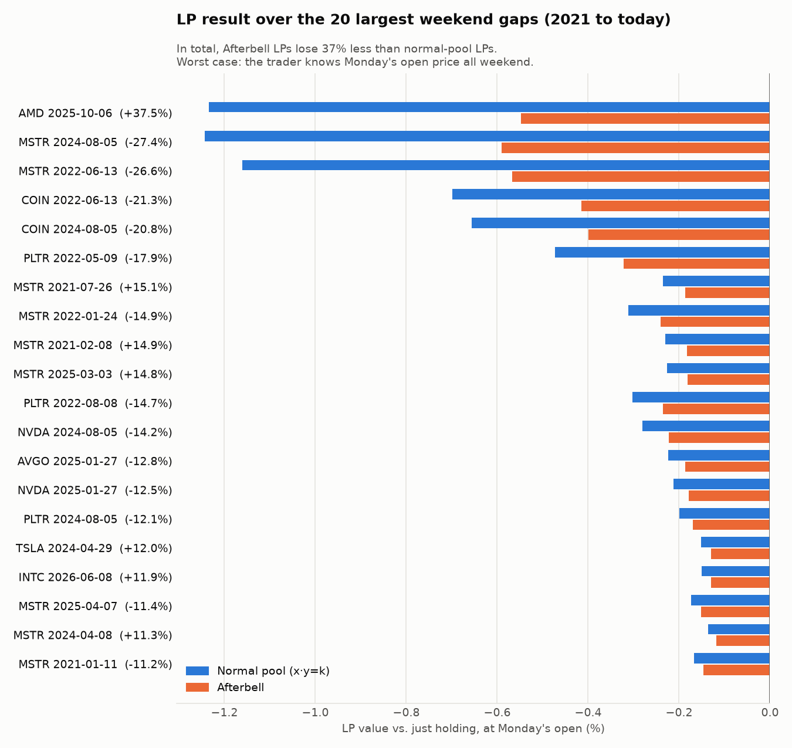
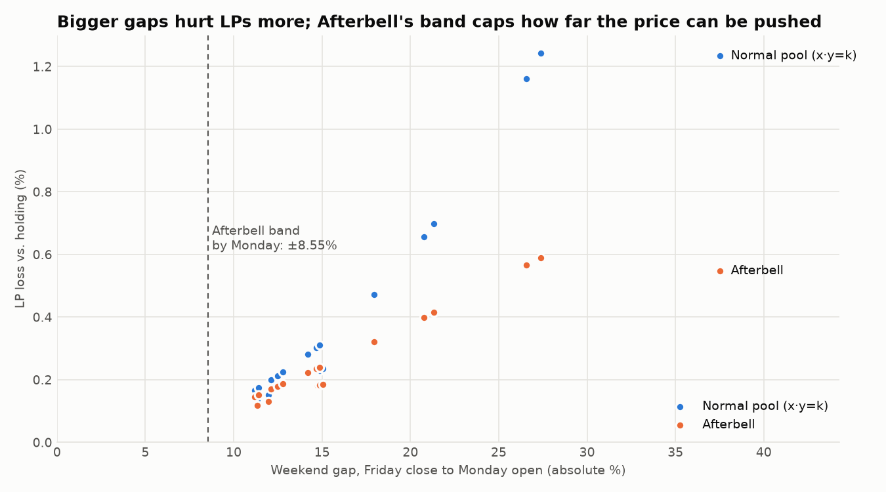

# Weekend-gap backtest

**Question:** when a stock's price jumps over a weekend, how much do LPs lose to a trader who already knows Monday's opening price? We compare a normal constant-product pool with Afterbell.

Run it with `pnpm backtest` from the repo root (needs [uv](https://docs.astral.sh/uv/)). The first run downloads prices; later runs use the cache in `data/`. Outputs go to `output/`: `results.json` (read by the web results page) plus `lp_vs_hodl.png` and `loss_vs_gap.png`.

## Result (2021-01-01 to 2026-09-25, 20 largest weekend gaps, $80k pool)

| | Normal pool (x·y=k, 0.30% fee) | Afterbell (devnet params) |
|---|---|---|
| LP result vs. just holding, all 20 weekends | **−$6,513** | **−$4,073** |
| Average per weekend | −0.42% | −0.26% |
| Worst weekend | −1.24% (MSTR, Aug 5 2024, −27.4%) | −0.59% (same weekend) |
| Fees earned | $188 | $275 |
| Value lost to stale prices (before fees) | $6,702 | $4,347 |

**Afterbell LPs lose 37% less** with the devnet parameters. The improvement is real but moderate, and the reason is worth understanding:

- **The band was the limit in every event.** It reaches ±8.55% by Monday (2% + 0.10%/hour × 65.5 h, under the 10% cap), and all 20 gaps were larger than 11%. The trader pushes the price to the edge of the band.
- **The first few percent of a move are the most profitable part for the trader,** because the pool is still selling at close to Friday's price while the true value is Monday's. The band stops the price at 8.55%, but everything up to there is still available to the trader.
- So Afterbell **halves** the loss on the biggest gaps (AMD +37.5%: −1.23% → −0.55%) but only trims it by 15–25% on 11–15% gaps.
- Fees help very little. The trader only trades while it's profitable, so higher fees mostly shrink how far they push, not what they already took.

### Sensitivity: the band width is the lever

The same 20 weekends with different closed-market settings (devnet config unchanged):

| Closed-market setting | Total LP loss | Less loss than the normal pool |
|---|---|---|
| devnet: band 2% + 0.10%/h, cap 10%; fee 0.60% + 0.01%/h | $4,073 | 37% |
| band grows half as fast (+0.05%/h) | $2,852 | 56% |
| flat 5% band | $2,774 | 57% |
| flat 2% band | $1,222 | 81% |
| devnet band, closed base fee 1.5% | $3,782 | 42% |
| looser: +0.30%/h, cap 20% | $5,881 | 10% |

**Caveat before tightening anything:** this backtest has no ordinary (uninformed) traders, so it can't show the *cost* of a tight band. That cost is weekend users who get turned away and the fees they would have paid. A flat 2% band looks best here only because nobody legitimate is trading. Choosing the band is a product decision this backtest can inform but not make.

## How it works

- **Data:** Yahoo Finance daily bars via yfinance 1.7.0, split- and dividend-adjusted (`auto_adjust=True`), for AAPL, MSFT, NVDA, AMZN, GOOGL, META, TSLA, AMD, NFLX, AVGO, JPM, COIN, PLTR, MSTR, INTC, BA. A weekend gap is Friday's close to the following Monday's open, with the two trading days exactly 3 calendar days apart (so long weekends are excluded). The 20 largest by absolute size are used.
- **Afterbell is the real program's math.** `afterbell_math.py` is a line-by-line Python port of `math.rs` and `mode.rs`. `test_parity.py` replays 120 swaps that the compiled Solana program executed (the same vectors the TypeScript SDK is checked against) and must reproduce every amount, price, mode and rejection exactly. It runs before every backtest and in CI.
- **Parameters** come from `config/devnet.json` (the TSLAx-test/USDC pool). The normal pool uses the same 0.30% fee as Afterbell's open-market fee.

## Assumptions (every one of them)

1. **Starting point:** both pools hold $40k of stock and $40k of USDC at Friday's close (the devnet seed amounts), priced at the close. Stock has 8 decimals, USDC 6.
2. **Weekend length:** 65.5 hours, from Friday 16:00 ET to Monday 09:30 ET. Afterbell is Closed the whole time, with its band and fee clock starting at the close (the last trusted price is the Friday close).
3. **The informed trader knows Monday's open from Friday's close.** This is a worst case for LPs. In reality news arrives during the weekend, so real losses would be smaller for **both** pools.
4. **Normal pool:** Uniswap-v2-style `x·y=k` with the fee kept in reserves. The trader moves the price until the next unit would cost more than Monday's price after the fee (buying stops at P1·(1−f), selling at P1/(1−f)). Timing doesn't matter for this pool.
5. **Afterbell trader:**
   - Every 15 minutes, trades in chunks of 0.2% of depth for as long as each chunk is profitable at Monday's price and inside the band.
   - Because the band only widens and the fee only rises, taking each price step at the first moment the band allows it is optimal.
   - Small chunks keep the size fee at its minimum of 1 bps, since the program rounds it up. **Design finding:** a trader who splits trades can avoid almost all of the size fee.
   - Chunks that would breach the band are halved and retried.
6. **Monday open:** Afterbell jumps to Monday's price with no trade, and nothing more is lost. The normal pool sits wherever the weekend trading left it.
7. **No uninformed flow, no other arbitrageurs, no transaction costs or latency.** Fees come only from the informed trader.
8. **Metrics:** everything is valued at Monday's open.
   - *LP vs. holding* = pool value − value of the starting tokens. This equals minus the trader's net profit.
   - *Stale-price loss* = trader profit + fees paid (the value lost before fees are counted back).
9. **Not modeled:**
   - halts (the pool pauses, so no trading and no loss);
   - Pyth confidence intervals;
   - the Token-2022 ScaledUiAmount multiplier;
   - intraday paths, which don't matter here because the trader already knows the destination price (see 3);
   - the fact that a normal pool would also lose its rebalancing loss on Monday even with no weekend. That loss is part of why oracle anchoring helps: Afterbell's jump to the new price moves no tokens.
10. **Event mix:** MSTR accounts for 9 of the 20 events because it is by far the most volatile of these stocks. The results are dominated by a few very large moves.
