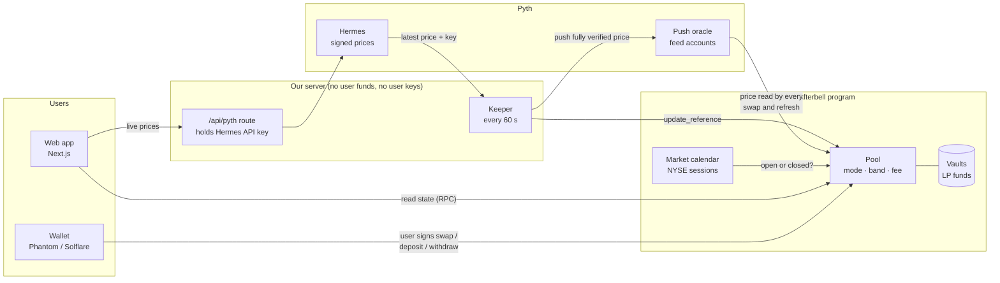

# Architecture

Afterbell is one Solana program plus the off-chain pieces that feed it prices, run the demo, and show it to people. The program holds all funds and enforces every rule; everything else is a convenience that could fail without putting money at risk.

## The pieces

| Piece | Where | What it does |
|---|---|---|
| Program | `programs/afterbell` | Pools, the market calendar, and every rule: oracle anchoring, the weekend band, weekend fees, halts, always-available withdrawals. Integer math only, rounding toward the pool. |
| SDK | `packages/sdk` | Instruction builders and account decoders, plus an exact TypeScript copy of the program's math, checked against 120 swaps the real program executed. `fetchMarkets` reads any number of pools in two RPC calls and computes what the program would do right now. `@afterbell/sdk/pyth-push` (server only) posts Hermes prices. |
| Config | `packages/config`, `config/*.json` | Everything network-specific (program id, mints, pools, feed ids, Pyth addresses), validated at startup. Secrets live in git-ignored `.env.<network>`. |
| Keeper | `services/keeper` | Keeps pools fresh. Pyth pools: fetch from Hermes, push into Pyth's feed account, `update_reference`. Mock pools (devnet demo): heartbeat + `update_reference`. Safe to run several at once; `/health`, `/metrics`, alerts after 5 minutes without an update. |
| Web app | `apps/web` | Dashboard, Swap, Liquidity, Pools, Results (backtest), Live data (real Pyth prices), Demo (devnet only). Reads the chain directly for now; users sign in their own wallet. |
| Scripts | `scripts` | Deploy, create mints and pools, seed liquidity, NYSE calendar, operator controls, `status`, `smoke`. |
| Backtest | `backtest` | 20 real weekend gaps, normal pool vs Afterbell, using a Python port of the program's math (same 120-swap check). Output feeds the Results page. |

## How a price reaches a trade

1. The keeper asks Hermes for the latest signed price (it has the API key).
2. It writes that price into Pyth's public on-chain feed account, verified by Wormhole signatures, and calls `update_reference`.
3. Every swap and deposit refreshes the pool first: it reads the feed account and the calendar, picks Open, Closed or Paused, and prices the trade.
4. While the calendar says the market is closed, new prices are ignored: Pyth keeps publishing stock prices overnight, but the pool stays inside its band around the last official price until the open.

## Devnet demo

The demo uses the mock oracle, which exists only in `devnet-mock` builds. Its forward-only simulated clock lets a whole week play out in about 30 seconds with the real devnet band and fee settings. The admin key for the demo is loaded into the browser tab's memory and never leaves it. Mainnet builds contain none of this, and CI checks both the program binary and the web build.

## What comes next (Phase 7)

Browsers will read from our own cached API and price relay instead of RPC and `/api/pyth`, fed by an indexer that stores every program event in Postgres. That also unlocks the "coming soon" items (24h volume, APR, fee history).
